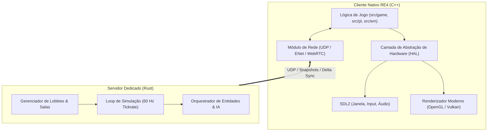

# Resident Evil 4: Roadmap do Porte Nativo & Multiplayer Cross-Platform

Este documento estabelece o planejamento técnico, marcos de desenvolvimento (milestones) e arquitetura de engenharia para transformar a descompilação de Resident Evil 4 em um jogo **nativo multiplataforma** com **multiplayer cooperativo via servidor dedicado em Rust**.

---

## 1. Visão Geral da Arquitetura

O sistema é dividido em duas frentes independentes que convergem no modo multiplayer:

---

## 2. Fases de Execução

### Fase 1: Fundação & Extração de Assets (Semanas 1 e 2)
> [!IMPORTANT]
> O código em C++ precisa de seus arquivos originais de mídia (texturas, modelos 3D, sons) para funcionar.

* **1.1. Extração de Assets:** Obter a imagem de disco de depuração do GameCube (`G4BE08`) e rodar os scripts de split e extração para gerar a pasta `data/`.
* **1.2. Mapeamento das Dependências do Console:** Isolar todo o código que conversa diretamente com o chip do GameCube em `src/lib/` (`GX_*` para vídeo, `DVD_*` para leitura de disco, `PAD_*` para controles e `OS_*` para threads).
* **1.3. Definição do HAL (Hardware Abstraction Layer):** Estruturar uma interface limpa em C++ que encapsule essas chamadas de sistema.

---

### Fase 2: O Porte Nativo para PC / Linux (Meses 1 e 2)
O objetivo desta fase é fazer o jogo rodar como um executável de computador comum (`./re4`), compilado com `clang` ou `gcc`, sem nenhum emulador.

* **2.1. File I/O Shim (`dvd.cpp` $\to$ SSD):**
  * Substituir o leitor de miniDVD do GameCube por leitura direta de arquivos do SSD via `std::filesystem` e `fopen`.
* **2.2. Janela e Entradas (`pad.cpp` $\to$ SDL2):**
  * Implementar criação de janela e captura de eventos usando **SDL2**.
  * Mapear teclado/mouse e gamepads modernos (Xbox, PlayStation, Switch Pro Controller).
* **2.3. Pipeline Gráfico (`src/lib/GX` $\to$ Modern Render):**
  * Mapear a máquina de estados gráficos do GameCube (o pipeline `GX` e estágios TEV) para **OpenGL 3.3+ ou Vulkan**, aproveitando a lógica já comprovada do Dolphin Emulator.
* **2.4. Primeira Sala Jogável:** Carregar e renderizar a primeira sala da vila com o Leon se movimentando.

---

### Fase 3: O Servidor Dedicado em Rust (Mês 3)
Enquanto a engine gráfica é polida, construímos o servidor autônomo que cuidará do multiplayer.

* **3.1. Especificação do Protocolo de Rede:**
  * Criação de structs binárias ultra compactas:
    * `PlayerSyncPacket`: ID, coordenadas `(X, Y, Z)`, ângulo de mira, arma equipada, animação atual.
    * `ShootEventPacket`: Timestamp, origem, direção e dano.
    * `EnemySyncPacket`: ID da entidade, vida, posição e alvo.
* **3.2. Servidor Rust (`re4-server`):**
  * Implementado com **`tokio`** e biblioteca de game networking UDP (como **`renet`**).
  * Tickrate fixo de 60 Hz.
  * Suporte a salas de 2 a 4 jogadores com sincronização de relógio e ping.
  * **Dynamic Entity Handoff:** Capacidade de transferir a autoridade da IA dos inimigos para outro cliente se um jogador oscilar a conexão.

---

### Fase 4: O MVP Multiplayer — *The Mercenaries Co-op* (Mês 4)
> [!TIP]
> Começar pelo modo Mercenários é a decisão mais estratégica do projeto. Ele não possui cutscenes longas, portas trancadas que exigem chaves ou puzzles complexos: é uma arena de combate pura com contagem regressiva e contagem de inimigos.

* **4.1. Instanciação do Player 2:**
  * Alterar o loop de [`mercenaries.cpp`](file:///home/max/Documentos/GitHub/re4/src/game/mercenaries.cpp) para instanciar duas entidades de player (ex: Leon e Ada).
* **4.2. Sincronização de Posição & Animações:**
  * O Player 1 envia sua posição para o servidor Rust $\to$ o servidor retransmite para o Player 2 $\to$ o Player 2 atualiza o modelo 3D local do Leon.
* **4.3. Sincronização de Inimigos e Dano:**
  * Aplicar dano instantâneo (*Client-Side Hit Registration*) para garantir sensação de tiro imediata mesmo com latência de rede.
* **4.4. Placar & Tempo Compartilhados:** Sincronizar o relógio da partida e a pontuação de combos entre os dois jogadores.

---

### Fase 5: Campanha Co-op & Multiplataforma Total (Mês 5+)

* **5.1. Transições de Salas na Campanha:** Sincronizar quando ambos os jogadores abrem portas e mudam de cenário em conjunto.
* **5.2. Builds Multiplataforma:**
  * **Linux & Steam Deck:** Pacote nativo `.AppImage` ou Flatpak com suporte ao Steam Input.
  * **Windows:** Compilação nativa com MSVC / Clang.
  * **Nintendo Switch:** Port para o ecossistema homebrew (libnx + SDL2).
  * **Android:** Compilação do executável com suporte a toque e controle via NDK.

---

## 3. Matriz de Riscos & Soluções Técnicas

| Desafio | Complexidade | Solução Arquitetural |
| :--- | :---: | :--- |
| **Renderizador GX da Nintendo** | Alta | Reutilizar a camada de tradução GX $\to$ GL/Vulkan open-source já testada pelo Dolphin. |
| **Endianness (Big-Endian vs Little-Endian)** | Média | O GameCube era Big-Endian; x86 e ARM são Little-Endian. Padronizar todos os pacotes de rede e structs em Little-Endian. |
| **Instabilidade de Conexão no P2P/Server** | Média | Registro de tiro no cliente (*Client-Side Hitreg*) e interpolação de movimento (*Dead Reckoning*). |
| **Dessincronização de IA dos Ganados** | Alta | Um único cliente calcula a IA e transmite os dados para os demais via servidor Rust. |

---

## 4. Próximos Passos Imediatos

1. Definir o ambiente de desenvolvimento de compilação da base C++ (Python 3, Ninja, compiladores).
2. Obter a imagem de disco `G4BE08` para montar o diretório de dados `data/`.
3. Inspecionar o ponto de entrada [`main.cpp`](file:///home/max/Documentos/GitHub/re4/src/game/main.cpp) para iniciar a prototipagem do shim SDL2.
